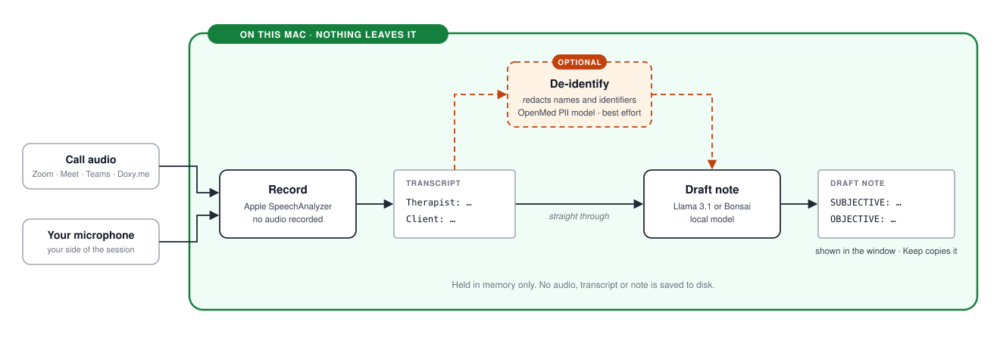

# soapcap-swift

A Mac app that turns a telehealth session into a **speaker-attributed
transcript** and a **drafted SOAP, DAP or BIRP note**, entirely on the Mac.
No cloud, no audio recorded, nothing saved to disk.

It has the same goal as [soapcap](https://github.com/pglockner/soapcap),
the command-line tool, and shares its prompts and test cases. It is its own
implementation: one window that captures, de-identifies and drafts by
itself.

**In development.** Everything below works, but there is no installer yet:
you build it with Xcode. For a finished tool, use soapcap.

[How it works](#how-it-works) ·
[Requirements](#requirements) ·
[Build and run](#build-and-run) ·
[Using the app](#using-the-app) ·
[Privacy](#privacy) ·
[Roadmap](#roadmap) ·
[soapcap and this app](#soapcap-and-this-app) ·
[Development](#development)

## How it works

<picture>
  <source media="(prefers-color-scheme: dark)" srcset="Assets/how-it-works-dark.svg">
  
</picture>

The app listens to **what the Mac is playing** and to **your microphone**,
so it works with any conferencing tool, FaceTime included, and never talks
to one.

## Requirements

| Requirement | Notes |
|---|---|
| macOS 26 (Tahoe) or newer, Apple silicon | |
| Full Xcode, and cmake | To build. The Command Line Tools alone are not enough; cmake (`brew install cmake`) builds the note engine |
| A note model | `llama3.1:8b` (the tested default, 4.9 GB) or Bonsai (5.9 GB), each a download from Settings. A model an [Ollama](https://ollama.com) on the Mac already has is used where it is. Recording works without one |
| The de-identification model (optional) | OpenMed's PII model, about 130 MB, installed from Settings |

## Build and run

```sh
./build.sh && open build/Soapcap.app
```

The first build fetches the de-identifier's packages and builds the note
engine, and takes a few minutes longer. Sign with a stable identity (see
[Signing and notarizing](#signing-and-notarizing)), or macOS forgets the
app's permissions on every rebuild.

## Using the app

**First run.** Soapcap opens on a setup screen that walks through the two
permissions macOS asks for, Microphone and System Audio Recording. Each has
a button that says what you are about to see, and the answer counts at
once. System Audio Recording is how macOS lets an app hear what the Mac is
playing: sound only, never the screen. macOS can't tell an app whether it
has that permission, so Soapcap finds out by playing itself a tone you
won't hear. **Check permissions** brings the same screen back later, with
speech recognition for your language, the note model, the de-identification
model and free memory, each with a button that puts it right.

**Record.** Use headphones and turn on Do Not Disturb. The window shows the
last few lines heard from each side. **Pause** stops listening and stops
the clock; **Resume** carries on in the same session. The session's time
also shows in the menu bar while it runs, where the call's window can't
cover it. A microphone that changes mid-session, such as AirPods
connecting, is picked up.

**De-identify** (optional). Names, phone numbers, dates and similar details
become tokens like `[FIRST_NAME_1]`, in the transcript and again in the
note. Speaker labels and clock times are kept. It is best effort, so read
the result before sharing it. If it fails, the text is shown under a red
"Not de-identified" banner rather than passed off as checked.

**Draft note.** Pick SOAP, DAP or BIRP.

- A draft with a missing or empty section is redone, up to three times, and
  the most complete one is kept.
- A SOAP note's Objective is a fixed mental-status frame filled in by a
  separate pass. It never says "No SI/HI reported" if risk language was
  seen.
- When only your side was heard, the section that rests on the client is
  not left to the model: a SOAP note's Subjective and Objective, a DAP
  note's Data and a BIRP note's Behavior each say they need completing by
  hand, and a caution under the note says so.
- Cautions about a draft (a section still missing, say) appear under the
  note and are never copied with it.
- **Keep** copies the note. **Regenerate** drafts it again.

**While drafting.** The window lists the steps of the draft as they are
done, with two small charts beside them: memory in use, and how much has
spilled over to disk as swap. They turn yellow and then red as the Mac
fills up. Bonsai takes about 8 GB: the app suggests closing other apps when
memory is short, and asks before drafting when the Mac is also deep in
swap. **Stop drafting** ends a draft and frees the model's memory; if you
were drafting again, the note you already had is still there. Otherwise the
model stays loaded until you discard the note, start a new session or quit.

**Settings** (Cmd-comma). The two speaker labels, the language to
transcribe in, the note model, and the session type on the note's first
line ("53 minutes, telehealth"). The two note models and the
de-identification model are downloaded here: each says how big it is first,
a download that is stopped carries on where it left off, and **Remove**
deletes a note model again. `llama3.1:8b` is not offered when Ollama
already has it. Ollama's address is under Advanced.

**Testing a note model.** **Test**, under the model's name in Settings and
on the Note model line of the checks screen, drafts a note from a made-up
session with the chosen model. It answers Good when every section came out
filled, or Problem with what was wrong, and the note can be read either
way. It takes as long as drafting a note does, nothing is kept, and it is
not offered while a session is being recorded.

**Uninstalling.** **Uninstall Soapcap…**, at the bottom of Settings, removes the models
the app downloaded, its settings and its permissions, then moves the app to
the Trash. A Bonsai or an Ollama that something else installed is left
alone.

**Note models.** `llama3.1:8b` is fast, usually under a minute a note.
Bonsai is more careful and slower, a few minutes a note. Both run on an
engine inside the app, except that `llama3.1:8b` is left to Ollama when
Ollama has it. They are the two the prompts were tested with, and no other
model is offered.

## Privacy

- **Nothing is saved.** Audio is never recorded. The transcript and the
  note live in memory and are gone when you start a new session or quit.
- **Nothing lands in a terminal.** A window has no scrollback and no
  window-restore snapshot.
- **The copied note is marked concealed**, so clipboard managers that honor
  that convention skip it.
- **Downloads only, nothing uploaded.** The note models and the
  de-identification model come from huggingface.co, and each file is
  checked against a pinned checksum. A copy soapcap or Ollama already has
  is used instead. Those downloads are the only time the app goes online,
  and nothing from a session is sent.
- **Ollama on another machine breaks the promise.** If its address is not
  this Mac, the transcript travels over the network, and the note says so.

## Roadmap

- [ ] Before a release candidate, try by hand what nobody has yet: a
      whole Bonsai download, and stopping a draft while Bonsai loads and
      with an Ollama model
- [ ] Register jukenzie.com, the domain the app's identifier
      (`com.jukenzie.soapcap`) is named after, before the first public build
- [ ] A design pass over every screen, to Apple's Human Interface
      Guidelines for macOS (Liquid Glass materials, SF Symbols), checked
      with Accessibility Inspector for VoiceOver and contrast
- [ ] A signed, notarized build that installs without Xcode
- [ ] Try **Uninstall Soapcap…** again from that build: from Applications,
      and opened straight from the download
- [ ] Later: go over the rules the note model is given, and rework them to
      say less of what not to do and show more examples to follow. A change
      to them needs a full comparison run before it can be trusted
- [ ] Stretch: the `structured` and `combined` note styles (nobody is
      asking for them yet). Notes are drafted in the narrative style only
- [ ] Idea, not scoped: note structure from a settings file, so a note's
      sections and their rules can be tailored without editing prompts and
      code

## soapcap and this app

| | soapcap | soapcap-swift |
|---|---|---|
| Form | Command-line tool | Mac app, one window |
| Setup | `./install.sh`, with Homebrew | Build with Xcode |
| Speech recognition | Apple SpeechAnalyzer, through `yap` | Apple SpeechAnalyzer, built in |
| De-identification | OpenMed's PII model, through a Python helper | The same model, built in |
| Saving to a file | Only if you ask | Never |
| Note styles | narrative, structured, combined | narrative |
| Settings | `config.sh` | Its own Settings window |

They share the prompts, the Objective frame and the checks applied to a
draft, and the app's tests reuse soapcap's cases so the two agree. A Bonsai
that soapcap installed is used where it is.

## Development

To see SwiftUI previews, open this folder in Xcode and select the
`SoapcapUI` scheme. The window lives in that library; `Soapcap` is only the
launcher. The app's version comes from `VERSION`, and its build number is
the commit count.

### Command-line checks

Three probes run a piece of the app without the window:

- `swift run CaptureProbe 15` records for 15 seconds and prints the
  transcript. `swift run CaptureProbe check` only says whether the Mac's
  audio can be heard. From a terminal, the permissions are the terminal's.
- `swift run NoteProbe FILE [soap|dap|birp] [MODEL] [MINUTES]` drafts a
  note from a transcript file, or from the sample session with `sample` in
  place of the file. The model is run the way the app would run it, and
  `gguf:PATH` runs any model file on the app's engine.
- `swift run -c release DeidentifyProbe FILE [note]` de-identifies a file.
  `--install` sets up the model first; `--windows` tries other passes.

### Note engine

`engine.sh` builds `llama-server` from PrismML's llama.cpp, at a pinned
commit, into `.build/engine`. `build.sh` runs it and puts the result inside
the app, which starts it for a draft and gives it a key only the app knows.
`SOAPCAP_ENGINE` names a different `llama-server`, for trying a build with
the probes.

The note models' files go in
`~/Library/Application Support/Soapcap/note-models`. `llama3.1:8b` is Meta's
Llama 3.1 8B Instruct in second-state's 4-bit conversion, under the Llama 3.1
Community License.

### De-identification model

The model is kept in
`~/Library/Application Support/Soapcap/deidentify-model`; delete that
folder to remove it. The text is read twice and the findings merged: a
detection pass in short overlapping chunks, and a context pass in long
ones. When the app is started from a terminal, `SOAPCAP_DEIDENTIFY_MODEL`
names a different folder, and `SOAPCAP_DEIDENTIFY_DIR` says where soapcap's
de-identify install is.

### Signing and notarizing

`build.sh` signs ad hoc unless `SOAPCAP_SIGN_IDENTITY` names a code-signing
identity, such as an Apple Development certificate (Xcode creates one for a
free Apple ID):

```sh
SOAPCAP_SIGN_IDENTITY="Apple Development: you@example.com (TEAMID)" ./build.sh
```

With an ad-hoc signature, macOS treats each rebuild as a different app and
drops its Microphone and System Audio Recording grants. To reset a stuck
grant, which also happens after switching from ad hoc to a certificate:

```sh
tccutil reset AudioCapture com.jukenzie.soapcap
tccutil reset Microphone com.jukenzie.soapcap
```

Every build runs under the hardened runtime. For a build that opens on
another Mac without a warning, sign with a Developer ID Application
identity and have Apple notarize it. `notarize.sh` uploads the app to
Apple, attaches the ticket and leaves a zip to ship:

```sh
SOAPCAP_SIGN_IDENTITY="Developer ID Application: Your Name (TEAMID)" ./build.sh
./notarize.sh
```

It uses credentials stored once with
`xcrun notarytool store-credentials soapcap-notary`. `SOAPCAP_BUNDLE_ID` and
`SOAPCAP_OUT` give a build its own identifier and folder, so that it can sit
beside the usual one with permissions of its own.

### Tests

```sh
swift test
```

| Bundle | Covers |
|---|---|
| `SoapcapCoreTests` | Transcript rendering and echo de-duplication (soapcap's cases); memory figures |
| `SoapcapCaptureTests` | Cutting recognizer output into segments; transcribing a clip spoken by `say` |
| `SoapcapNoteTests` | The checks and fixes on a draft (soapcap's cases); the drafting sequence; both model backends against stand-ins |
| `SoapcapDeidentifyTests` | The rules (soapcap's cases); speaker labels left alone; installing the model |
| `SoapcapPIITests` | The real PII model on the transcripts in `Samples/deidentify`; skipped when the model isn't installed |
| `SoapcapUITests` | The session flow against scripted stand-ins; starting and stopping the note model; settings; credits |

Live capture, the permission grants, signing and the window itself are not
covered. They need a person.

Two tests run only when asked, and are skipped otherwise:

```sh
SOAPCAP_MODEL_TESTS=1 swift test --filter SampleNoteTests
SOAPCAP_NETWORK_TESTS=1 swift test --filter FetcherNetworkTests
```

The first drafts the sample session's note with the default model and
checks that it comes out whole, as the app's Test button does: the baseline
check that a model on this Mac is working. It takes about a minute. Give
the variable a model's name instead of `1` to try that one. The second
stops and resumes a real 130 MB download.

The sample session is soapcap's `03-selfreport-diagnosis-9min`, an
entirely fictional nine-minute session, in
`Sources/SoapcapNote/Resources/samples`. It says a model is working, not
how good its notes are: a note's wording changes from one draft to the
next, so there is no expected text to compare with.

## Credits

The app menu's **Acknowledgements** lists the projects the app is built on
and their licences.
